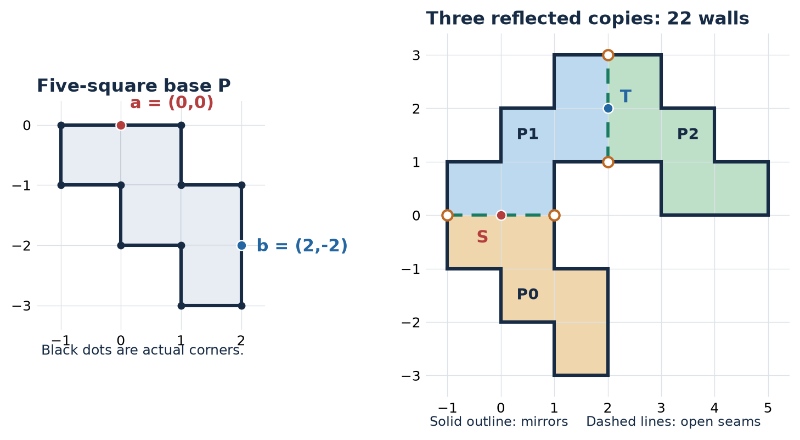
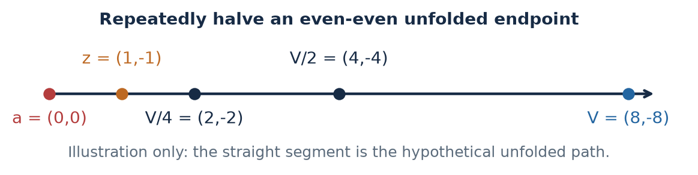
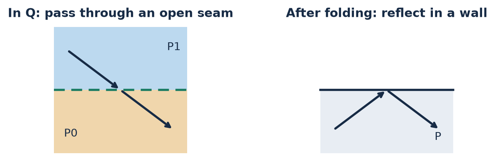
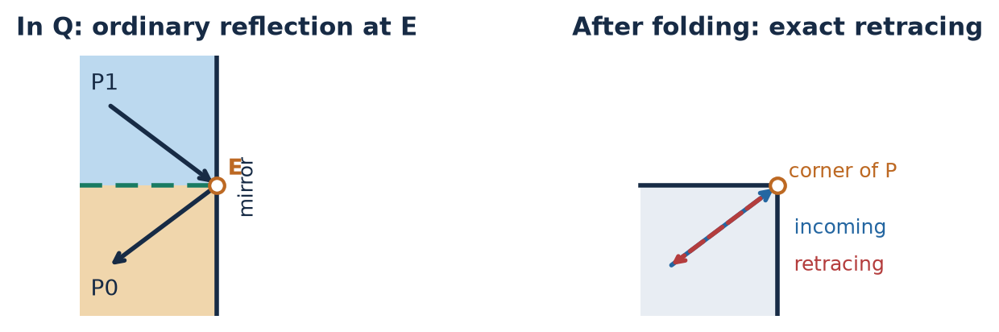

# A 22-wall mirror room

An expanded elementary proof, with the seam events shown explicitly.

Statement. In the room below, S = (0,0) and T = (2,2) cannot be joined by any finite, corner-avoiding billiard path.

The mirrors are the solid outside boundary. Dashed lines are open passages between copies; they are not mirrors. A path may reflect at a smooth point of a wall, but it may not hit an actual corner.

## Build the room from one five-square piece

Let P be the union of the five closed unit squares with lower-left corners (-1,-1), (0,-1), (0,-2), (1,-2), (1,-3). Mark a = (0,0) and b = (2,-2) on its boundary. Both are smooth wall points, not corners.

Take these three reflected copies:

P0 and P1 meet on the horizontal interval [-1,1] x {0}. P1 and P2 meet on the vertical interval {2} x [1,3]. Their interiors are disjoint, and there are no other contacts. Their union Q is a simple polygon.

S is the midpoint of the first seam and T is the midpoint of the second. Folding every copy back onto P sends S to a and T to b. We will show that a connecting path in Q would force an impossible connection in P.

---

# 1. The lattice obstruction in P

First consider ordinary billiard paths in P. Here is its complete integer-point census.

Integer-point census: only a and b are smooth; seven convex and three concave corners, no interior integer points.

## Reflecting across an integer-coordinate wall preserves parity

Reflection in a vertical wall x = c changes x to 2c - x. Reflection in a horizontal wall y = d changes y to 2d - y. Here c and d are integers. Thus both kinds of reflection preserve the integer lattice and each coordinate modulo two. The inverse unfolding maps are compositions of the same reflections, so they preserve parity too.

Assume an ordinary path joined a to b. Unfold its reflections: reflect each successive copy of P instead of bending the ray. The path becomes a straight segment from a = (0,0) to an image V of b. Both coordinates of b are even, so both coordinates of V are even. Also V is nonzero: unfolding preserves the positive length of the proposed path.

## An odd-coordinate integer point occurs before V

Halve both coordinates of V while both are even. Stop at the first integer point z with an odd coordinate. At least one division was made, so z lies strictly between 0 and V on the unfolded segment.

Fold z back along the proposed path. Its image is an integer point of P with at least one odd coordinate. It is therefore neither a nor b. By the census, it is an actual corner. That contradicts corner avoidance. If z is exactly at a join between unfolded copies, the same argument still identifies an actual boundary corner.

Conclusion 1. No ordinary corner-avoiding billiard path in P joins a to b.

---

# 2. The two kinds of seam event

Inside each copy, folding preserves straight motion and ordinary wall reflections. Two events need to be distinguished.

## Crossing the interior of an open seam

The two folding maps agree on the seam and reflect the normal velocity component. A straight crossing in Q therefore becomes an ordinary reflection in a smooth wall of P.

## Hitting a seam endpoint on the outside wall

For example, let E = (1,0). A ray approaching E through P1 has physical velocity (u,-v), with u,v > 0. Before the hit, folding by (x,y) -> (x,-y) gives velocity (u,v). The actual vertical mirror changes the physical velocity to (-u,-v), and the ray now enters P0. Its folded velocity is also (-u,-v). The folded path reverses exactly, along the line it just followed.

The four endpoint images are (-1,0)->(-1,0), (1,0)->(1,0), (2,1)->(2,-1), (2,3)->(2,-3).

In the table, (p,q) is the incoming folded velocity; its components may have either sign. The listed maps hold in both directions of travel. All other base-corner preimages are actual corners of Q and cannot be hit. In particular, the three concave base corners give nine actual concave corners of Q. The 21 convex-corner incidences give 13 actual convex corners and two incidences at each of the four smooth points above. This accounts for all 30 corner incidences.

---

# 3. Why a reversal cannot help

A projected path can revisit a or reach b before the physical ray reaches T. The following choice of subpath handles those possibilities.

Step A. Suppose a finite valid path in Q joined S to T, and fold it onto P. Stop the folded path at its first arrival at b. Within that prefix, start at its last visit to a. Call this subpath gamma. It goes from a to b and has no interior visit to either mark.

At every interior or smooth-wall point of P, folded motion follows the ordinary billiard law of P, regardless of the current copy. Thus ordinary folded motion is deterministic and reversible.

Step B. If gamma has a corner reversal of the kind shown on page 3, take the first one. Before it, gamma has only ordinary reflections at smooth walls of P. Those reflections are deterministic and reversible. After reversing, gamma must retrace that same route until it returns to its starting point a.

Let d be the length from the start of gamma to this first reversal. The next d units of travel must retrace that same route backward. If gamma ended at b during that retrace, then b would already lie on its preceding route, contrary to Step A. At the end of the retrace it is at a, not b. Thus this return to a is an interior visit. This contradicts Step A, so gamma has no corner reversal.

Step C. Gamma is now an ordinary corner-avoiding a-to-b billiard path in P. Conclusion 1 says that no such path exists. Therefore the original S-to-T path in Q does not exist.

## Why the first and last visits are well defined

An axis-parallel path cannot connect S to T: reflection in an orthogonal wall cannot create a missing velocity component, while both coordinates of S and T differ. Every possible connecting path is therefore nonaxial. Reflections change only signs, so both velocity components stay nonzero. Each of its finitely many straight legs crosses each of the two seams at most once. Folding subdivides it into finitely many nonconstant straight pieces, so there are only finitely many visits to either mark.

## The other preimages of the marks

The extra preimages are smooth boundary points. Step A allows all their possible visits; it does not assume that a return to a must be a return to S.

## Cyclic coordinates of the 22-wall boundary

(-1,-1), (0,-1), (0,-2), (1,-2), (1,-3), (2,-3)
(2,-1), (1,-1), (1,1), (3,1), (3,0), (5,0)
(5,1), (4,1), (4,2), (3,2), (3,3), (1,3)
(1,2), (0,2), (0,1), (-1,1)

This proves the stated dark pair for every finite corner-avoiding billiard path. It makes no assumption about a bound on directions, path length or number of reflections.
