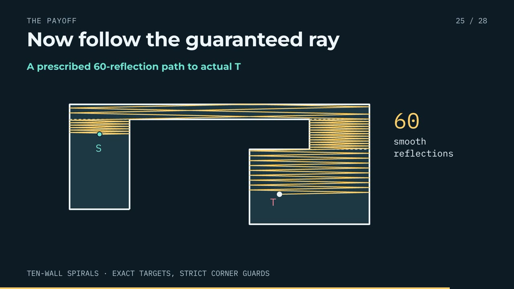

# The ten-wall spiral puzzle

[Watch or download the video](ten-wall-spirals.mp4) · [Read the manuscript](../../preprints/ten-wall-spirals/manuscript.pdf) · [Transcript](narration.md) · [All explainers](../README.md)



**10:00 · 1920×1080 · 30 fps · narrated for math students.**

Tall-or-wide all-real proof and the separate coprime thin-cap even-even theorem, with an exact archived 60-reflection worked path. Protected L/U constructions are cited dependencies.

Source authors: **Daniel Wang and Peyton Wang**. The manuscript is a working draft, not externally refereed; the video does not establish historical novelty or a universal minimum-wall result. Codex and Claude assisted the research and exposition. The authors remain responsible for the mathematics.

## Editable source

- `index.html` assembles the timeline and audio.
- `compositions/` contains the scene HTML, inline CSS, SVG diagrams, and GSAP JavaScript animations.
- `assets/audio/` contains the narration used by the project.
- `script.json`, `timeline.json`, and `narration.md` contain the script and timing data.
- `hyperframes.json` and `package.json` configure HyperFrames and pin its CLI version.
- `chapters.ffmeta` supplies the MP4 chapter markers; `video.json` records the manuscript, scope, and delivered checksums.

## Preview, check, and render

Install Node.js 22+, Python 3, and FFmpeg, then run from this directory:

```sh
npm run dev
npm run check
npm run render
```

The preview command uses HyperFrames 0.9.28, tested after an editor update-loop error with 0.9.27. Checks and delivery rendering retain the original 0.9.27 version.

The render command writes `renders/ten-wall-spirals.mp4`, preserves the authored narration, and adds chapter metadata. It leaves the checked-in video unchanged. The first use downloads the pinned HyperFrames runtime; project-specific audio and diagrams are included. Rendered bytes may vary with browser, encoder, and platform versions.

## Chapters

- 0:00 — The puzzle
- 0:49 — Two routes to existence
- 1:07 — Reduce the problem
- 1:47 — The geometric proof
- 4:25 — The twist
- 5:07 — The arithmetic proof
- 8:24 — The payoff
- 8:49 — Finish the theorem
- 9:38 — The answer
